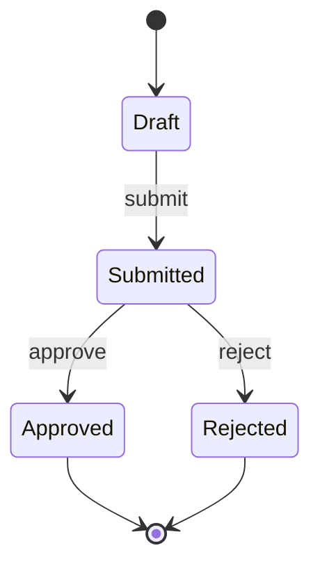
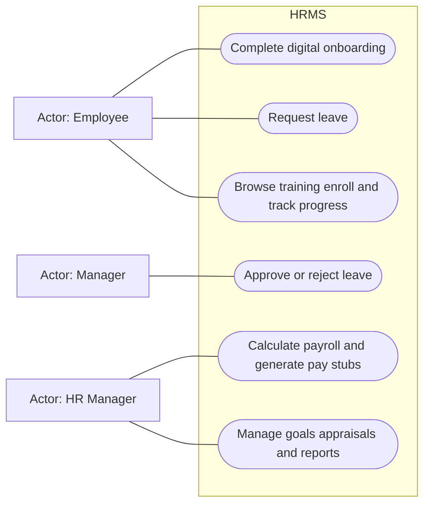
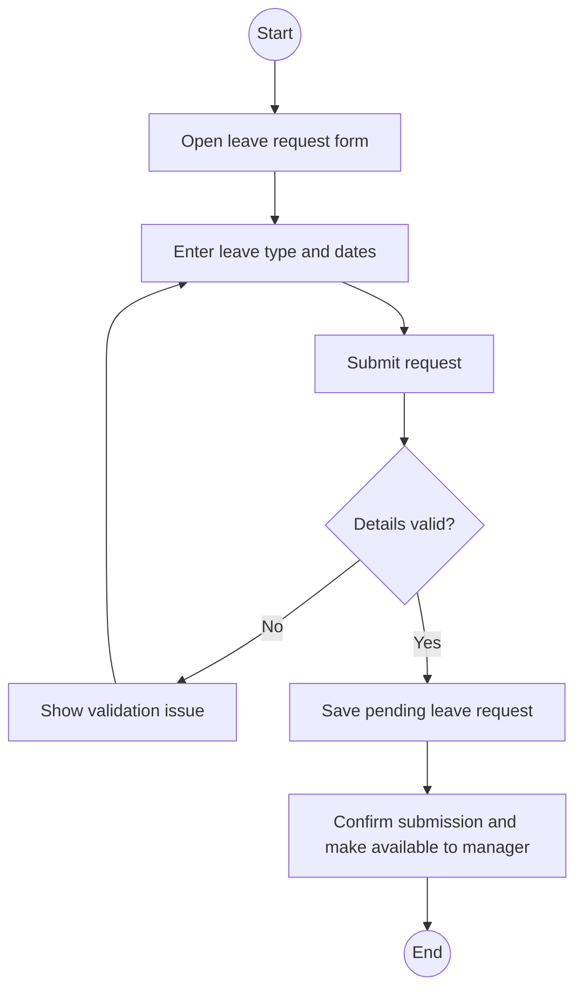

# Software Engineering: Fall 2023 Midterm with Study Answers

Source: supplied `Fall 2023-SE-MID TERM.docx`, CSE4070, Section A and Section B. The paper specifies 60 minutes, all questions compulsory and 25 marks: theory 14, case 11.

These are explanatory study answers, not an official marking scheme. Questions are transcribed below; the case statement is condensed while preserving its examinable requirements. Source references identify the lecture supporting the method. Any added assumptions are labeled.

## Part A: Short questions (7 x 2 = 14 marks)

### Q1. What is the Spiral Model in software development and why is it special?

**Source:** W1 Ch02 s9,18; W3 Ch04 s6-7.

**Notes:** [Process models](../notes/02_Week1_ProcessModels.md#6-spiral-slides-9-18).

**Answer:** Spiral is an iterative, risk-driven process in which the product evolves through repeated cycles of planning, risk assessment, engineering and evaluation. Its distinguishing feature is explicit risk management combined with stakeholder feedback before committing to further development. It suits complex/high-risk work but needs experienced people and sound risk analysis.

**How to explain:** repeating work is not unique to spiral; emphasize how risk informs the next cycle.

### Q2. Why do Agile teams need customer collaboration?

**Source:** W3 Ch03 s2,4-6; Ch04 s8-9.

**Notes:** [Agility](../notes/05_Week3_Agility_Process.md#1-agility-and-the-cost-of-change-slides-2-4-17).

**Answer:** Collaboration clarifies goals and priorities, supplies frequent feedback on working increments, and lets the team adjust when needs change. It reduces the risk of completing a technically correct product that solves the wrong problem.

**Example:** the customer can correct a mistaken registration workflow after an early prototype rather than after the entire system is finished.

### Q3. Why do we need requirement analysis in software development?

**Source:** W4 Ch07 s2-3,16-17; W5 Ch08 s2-6.

**Notes:** [Purpose and models](../notes/09_Week5_RequirementsModeling.md#1-purpose-and-kinds-of-models-slides-2-6).

**Answer:** Requirements analysis refines stakeholder needs into understandable information, functional and behavioral models, identifies interfaces and constraints, and reveals ambiguity, omissions and conflicts before design and coding. It provides a basis for design, testing and stakeholder agreement.

### Q4. List any four reasons why software projects can run into problems.

**Source:** W2 Ch24 s6,8-9; Ch25 s22.

**Notes:** [Late projects](../notes/04_Week2_Planning_Estimation_Scheduling.md#7-agile-estimation-and-late-projects-slides-21-22).

**Answer:** Four valid examples are unrealistic deadlines, underestimated effort/resources, changing requirements without revising the plan, and poor communication. Other slide-supported examples include unconsidered risks, technical difficulties and failure to detect/correct slippage.

### Q5. Provide a brief explanation of data modeling.

**Source:** W5 Ch08 s3; W6 Ch09 s19.

**Notes:** [Data design](../notes/10_Week6_DesignConcepts.md#7-data-and-architecture-elements-slides-19-20).

**Answer:** Data modeling describes the information domain: relevant objects, their attributes and relationships, independently of the processing logic. For example, Employee has an identifier and department, while LeaveRequest relates an employee to dates and a request status.

### Q6. Explain requirement modeling for WebApps in simple terms.

**Source:** supplied Pressman/Maxim 8e, Ch11 section 11.5, printed pp214-218. This is textbook context beyond detailed coverage in the supplied 9e lecture decks.

**Notes:** [WebApp supplement](../notes/14_Supplement_WebApps_UML.md#1-why-webapps-need-requirements-analysis-8e-section-115).

**Answer:** It turns stakeholder goals and scenarios into models of what a WebApp must provide: content, user interaction, processing functions, navigation and the operating configuration. These models reveal missing or inconsistent requirements before implementation. For a booking app, this includes flight information, the booking interaction, fare processing and movement from search to confirmation.

### Q7. Illustrate (Draw) the symbols used in state diagrams and share their names.

**Source:** W4 Ch07 s12; W5 Ch08 s30 and explanation s41.

**Notes:** [State and activity notation](../notes/14_Supplement_WebApps_UML.md#7-state-and-activity-notation-ch07-s12-and-ch08-s24-33).

**Answer:** Draw a filled circle (initial pseudostate), rounded rectangles (states), directed arrows (transitions) and a bull's-eye (final state). Label transitions with an event and, when appropriate, a guard/action.

This small diagram demonstrates the notation, not a state model mandated by the paper. In a handwritten answer, name the symbols beside the drawing.

## Part B: Modernizing an HRMS (11 marks)

### Case statement and source limits

XYZ Corporation wants to modernize its HRMS. It must support digital onboarding including document submission, training registration and account creation; leave requests and manager decisions; accurate salaries/deductions/taxes and electronic pay stubs; performance goals/appraisals/reports; and a training catalog, enrollment and progress tracking.

Data must be protected in storage/transit using role-based access and encryption. The system must scale with workforce growth. Critical functions must respond in **under 2 seconds even at peak usage**. Availability is **24/7 with at most 2 maintenance downtime hours per year**. The interface should be intuitive and user training take **no more than 1 hour**.

These values are from this case only. They must not be copied into the 2024/2025 cases.

### B1. Functional and nonfunctional requirements (4 marks)

**Source:** W4 Ch07 s4; W5 Ch08 s2-3.

**Notes:** [FR and NFR](../notes/08_Week4_UnderstandingRequirements.md#2-functional-and-nonfunctional-requirements-slide-4).

| Functional area | Required behavior |
|---|---|
| Onboarding | Submit documents, register for training, create an account |
| Leave | Employee requests leave; manager approves/rejects |
| Payroll | Calculate salary, deductions and taxes; generate electronic pay stub |
| Performance | Set goals, conduct appraisals, generate performance reports |
| Training | Browse catalog, enroll, track progress |

| NFR | Requirement from the case |
|---|---|
| Security | Secure storage/transmission, RBAC, encryption |
| Scalability | Accommodate workforce growth and expansion |
| Performance | Critical responses <2 seconds even at peak load |
| Availability | 24/7; maintenance downtime at most 2 hours/year |
| Usability/learnability | Intuitive UI; training no longer than 1 hour |

Do not silently generalize "maintenance downtime" into every possible type of outage; preserve the wording given.

### B2. Use case diagram (4 marks)

**Source:** W4 Ch07 s8-10; W5 Ch08 s7-13.

**Notes:** [Use case diagrams](../notes/09_Week5_RequirementsModeling.md#3-use-case-diagrams-slide-13).

Roles stated by the case: Employee, Manager and HR Manager. **Assumption:** HR Manager initiates payroll processing, because the case specifies its behavior without naming a payroll operator. A separate Payroll Officer would be another reasonable explicitly stated assumption.

Mermaid uses labeled external boxes for actors and rounded goal nodes. For handwritten UML, replace actor boxes with stick figures and goals with ovals; keep the system boundary.

Onboarding groups document submission, training registration and account creation. Grouped use cases are acceptable for a compact study diagram if their constituent behavior is explained; separate ovals can show them when space permits.

### B3. Use case description for leave request (2 marks)

**Source:** W4 Ch07 s8; W5 Ch08 s8-12.

**Notes:** [Description template](../notes/09_Week5_RequirementsModeling.md#2-actors-profiles-and-use-cases-slides-7-13).

| Field | Description |
|---|---|
| Name | Request Leave |
| Primary actor | Employee |
| Goal | Record a leave request for a manager's decision |
| Preconditions | Employee has an account and authorized access; authentication is a study assumption |
| Trigger | Employee selects the leave-request function |
| Main flow | 1. System presents the form. 2. Employee selects leave type and dates and submits. 3. System validates the submitted details. 4. System records the request as pending. 5. System confirms submission and makes the request available to the manager. |
| Alternative | Invalid/missing details: explain the issue and let the employee correct them. Cancellation before submission leaves no submitted request. |
| Postcondition | A valid request exists awaiting a manager's approval/rejection |

Field validation and the Pending status are modeling assumptions, not extra sentences in the case. Do not claim approval as the result of **request submission**: that is the manager's separate goal.

### B4. Activity diagram of employee request (1 mark)

**Source:** W5 Ch08 s23-24,31-33.

**Notes:** [Activity modeling](../notes/09_Week5_RequirementsModeling.md#6-functional-and-activity-modeling-slides-23-24-31).

For paper UML, use a filled initial circle and bull's-eye final rather than the text-labeled circles used by this flowchart. Authentication is treated as a precondition in both description and diagram.

## Answer summary

| Area | Recall cue |
|---|---|
| Spiral | Risk-driven cycles and feedback |
| Agile | Frequent collaboration validates priorities and increments |
| Analysis | Understand needs, interfaces and constraints before design |
| Project problems | Deadline, estimates, change, communication/risks |
| Data | Objects, attributes, relationships |
| WebApps | Content, interaction, function, navigation, configuration |
| Case | Preserve the exact NFR numbers; keep request and approval distinct |
