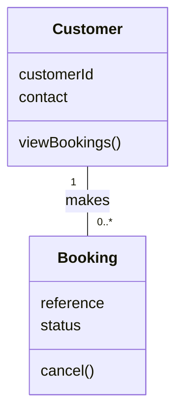
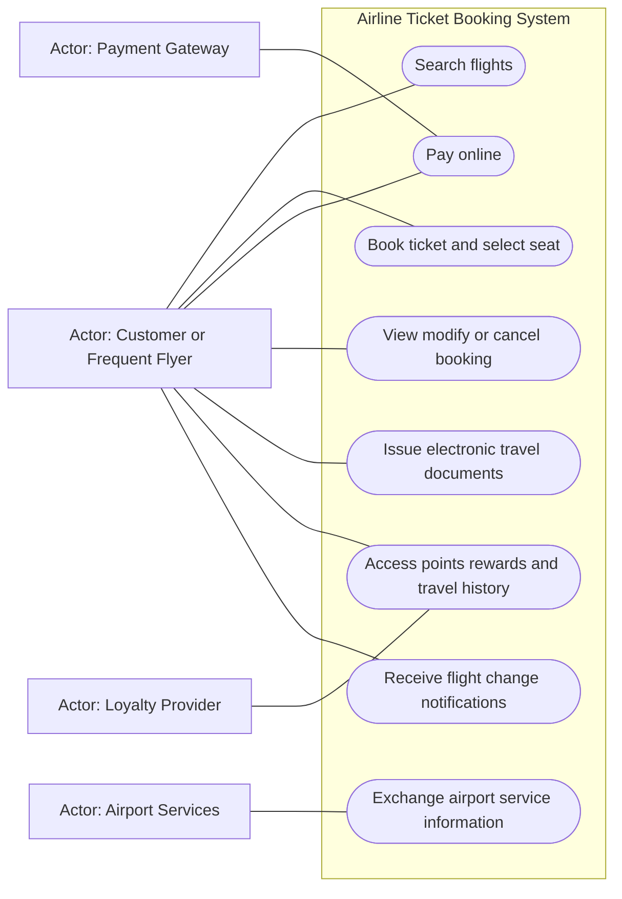
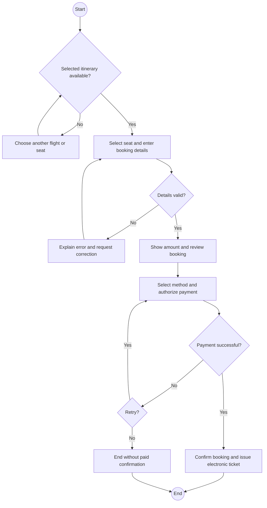

# Software Engineering: Fall 2024 Midterm with Study Answers

Source: supplied `Fall 2024-SE-MID TERM (1).docx`, CSE4070. The paper specifies 60 minutes and 25 marks: theory 14, case 11. All questions are compulsory.

These are study answers, not an official marking scheme. Theory questions are transcribed; the case is condensed without dropping the stated requirements. Modeling assumptions are marked.

## Part A: Short questions (7 x 2 = 14 marks)

### Q1. What is a Legacy System? Why should it be replaced?

**Source:** W1 Ch01 s6.

**Notes:** [Legacy software](../notes/01_Week1_Software_SoftwareEngineering.md#3-legacy-software-and-reasons-for-change-slide-6).

**Answer:** A legacy system is an existing, often long-lived system still supporting business operations. Replacement or modernization may be needed when it cannot meet new business needs, integrate with modern systems, adapt to technology or operate safely/economically in the required environment. Age alone is insufficient: adaptation may be preferable when the system remains useful and maintainable.

### Q2. Explain the Waterfall Software Development Process. When should it be used, and when should it not be used?

**Source:** W1 Ch02 s7,16.

**Notes:** [Waterfall](../notes/02_Week1_ProcessModels.md#4-waterfall-slides-7-16).

**Answer:** Waterfall organizes communication, planning, modeling, construction and deployment primarily in sequence. It is reasonable for well-understood work with stable requirements and predictable scope. It fits poorly where needs are uncertain or change frequently, because late feedback/testing can require costly rework of earlier decisions.

### Q3. What is Content Analysis in requirement modeling for WebApps? Explain it.

**Source:** supplied Pressman/Maxim 8e Ch11 section 11.5.4, printed pp216-217; textbook context beyond detailed 9e slide coverage.

**Notes:** [Content analysis](../notes/14_Supplement_WebApps_UML.md#3-content-analysis-and-content-model-8e-section-1154).

**Answer:** Content analysis identifies the information a WebApp must provide, the relevant content objects and their attributes/relationships. It derives these from user scenarios and organizes them in a list, model or data tree to expose omissions before design. For an airline app, examples are flight details, fare information and booking confirmation content.

### Q4. What factors should a Software Project Manager consider when choosing a Software Project Team?

**Source:** W2 Ch24 s5-9.

**Notes:** [Team factors](../notes/03_Week2_ProjectManagement.md#4-choosing-a-team-structure-slide-5).

**Answer:** Consider problem difficulty, product size, team lifetime, possible modularization, required quality/reliability, deadline rigidity and communication requirements. Match skills and experience to the work and encourage compatible collaboration. The seven listed factors concern **team structure**, not only the number of developers.

### Q5. List four key elements of Requirement Analysis.

**Source:** W4 Ch07 s9; W5 Ch08 s3.

**Notes:** [Taxonomy warning](../notes/14_Supplement_WebApps_UML.md#4-generic-analysis-elements-and-the-four-element-question).

**Study answer, conditional on the intended four-element grouping:** scenario-based elements (actor interactions), class-based elements (classes/relationships), behavioral elements (events/states), and flow-oriented elements (data transformations).

**Source limitation:** the provided Ch08 s3 instead lists five model types, additionally separating data models; Ch07 illustrates three groups. The old question alone does not establish the instructor's expected four. Learn the meanings and confirm the expected taxonomy; do not confuse these with RE tasks or design-model elements.

### Q6. Briefly explain the CRC (Class-Responsibility-Collaborator) Model.

**Source:** W5 Ch08 s20-22.

**Notes:** [CRC](../notes/09_Week5_RequirementsModeling.md#5-crc-modeling-slides-20-22).

**Answer:** CRC uses cards to identify analysis classes, their responsibilities and the other classes they collaborate with. Write the class name at the top, responsibilities on the left and collaborators on the right. Walking through a use case checks whether responsibilities/collaborations cover its behavior.

**Example:** Booking records itinerary and status, collaborating with Customer, Flight and Payment.

### Q7. Draw the symbols used in Class diagrams and label their names.

**Source:** W4 Ch07 s11; W6 Ch09 s11,30; additional standard-UML notation is explicitly contextual.

**Notes:** [Class notation](../notes/14_Supplement_WebApps_UML.md#6-class-notation-ch07-s11-and-ch09-s11).

Draw a class rectangle with **name / attributes / operations**, an association line and multiplicities. Show generalization with a hollow triangle pointing to the parent, and aggregation with a hollow diamond at the whole.

Additional standard-UML symbols: filled diamond = composition; dashed arrow = dependency; `+`, `-`, `#` = public/private/protected.

This small study diagram illustrates compartments, association and multiplicity. It is not a complete domain model required by the case.

## Part B: Airline Ticket Booking System (11 marks)

### Case statement

Airjet Airlines wants a modern ATBS. Customers search flights by destination, dates and class; book, choose seats and pay through multiple options; view/modify/cancel bookings; and receive electronic tickets and boarding passes.

Frequent flyers log in to view points, redeem rewards and inspect travel history. Customers receive email/SMS notifications for flight changes, cancellations and gate changes. The system integrates with payment gateways, loyalty providers and airport services and supports desktops, tablets and mobile phones with a user-friendly interface.

The introduction names security and scalable growth as goals. **No numerical response time, uptime or capacity target is given.**

### B1. Functional and nonfunctional requirements (4 marks)

**Source:** W4 Ch07 s4; W5 Ch08 s2-3.

**Notes:** [FR and NFR](../notes/08_Week4_UnderstandingRequirements.md#2-functional-and-nonfunctional-requirements-slide-4).

| Functional group | Required behavior |
|---|---|
| Search | Filter by destinations, dates and class |
| Booking | Book tickets and choose seats |
| Payments | Accept multiple online payment options |
| Manage bookings | View, modify or cancel |
| Travel documents | Issue electronic tickets and boarding passes |
| Loyalty | Login, view/redeem points, view travel history |
| Notifications | Send email/SMS about status, cancellation and gate changes |
| Integration | Exchange information with payment, loyalty and airport services |

NFRs: security, scalability for growth, compatibility/accessibility across the specified device categories, and usability/user-friendly interaction.

Integration has functional interface behavior as well as interoperability constraints. Explain the chosen classification rather than omitting it.

### B2. Use case diagram (4 marks)

**Source:** W4 Ch07 s8-10; W5 Ch08 s7-13.

**Notes:** [Use case diagrams](../notes/09_Week5_RequirementsModeling.md#3-use-case-diagrams-slide-13).

Customer covers the frequent-flyer role when using loyalty functions. External payment, loyalty and airport services are explicitly named in the statement.

The statement does not detail the airport interface, so the diagram keeps that interaction generic. More precise responsibilities require clarification. For handwritten UML, use actor stick figures and ovals; the Mermaid shapes are a Markdown rendering aid.

### B3. Use case description for Book Ticket (2 marks)

**Source:** W5 Ch08 s8-12.

**Notes:** [Description template](../notes/09_Week5_RequirementsModeling.md#2-actors-profiles-and-use-cases-slides-7-13).

| Field | Description |
|---|---|
| Goal | Confirm and pay for a selected flight booking |
| Primary actor | Customer |
| Supporting actor | Payment Gateway |
| Preconditions | Customer has selected a flight; selected itinerary is available |
| Trigger | Customer chooses to book |
| Main flow | 1. System shows flight/class and available seats. 2. Customer selects a seat and supplies required booking details. 3. System validates details and shows the payable amount. 4. Customer selects a payment method and authorizes payment. 5. Gateway reports success. 6. System confirms the booking and issues the electronic ticket. |
| Alternatives | No availability: choose another flight/seat. Invalid details: correct them. Payment fails: keep booking unconfirmed and offer retry/another method. |
| Postcondition | A confirmed paid booking and electronic ticket exist; on payment failure no paid confirmation is issued |

Validation, selected-details fields and failure handling are study assumptions for a coherent scenario. Login is **not** asserted as a universal booking precondition: the case explicitly requires it for loyalty access. Boarding-pass timing is not specified, so this model does not invent issuance at purchase time.

### B4. Activity diagram for Book Ticket (1 mark)

**Source:** W5 Ch08 s23-24,31.

**Notes:** [Activity modeling](../notes/09_Week5_RequirementsModeling.md#6-functional-and-activity-modeling-slides-23-24-31).

The diagram begins with the selected-flight precondition, matching the description. In paper UML, use standard initial/final symbols.

## Answer summary

| Area | Recall cue |
|---|---|
| Legacy | Business/technology/integration need, not age alone |
| Waterfall | Stable scope; poor response to frequent change |
| Content | Information objects, attributes, relationships |
| Team | Difficulty, size, lifetime, modularity, quality, deadline, communication |
| CRC | Class, responsibilities, collaborators |
| Case | Search/book/pay/manage/loyalty/notify; no invented SLA numbers |
