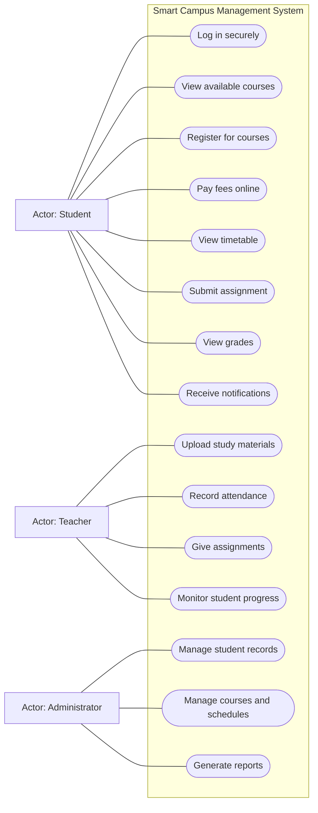
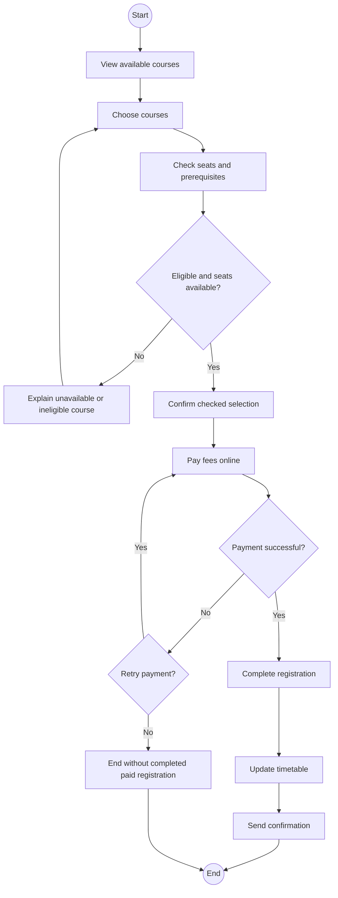

# Software Engineering: Fall 2025 Midterm with Study Answers

Source: supplied `Fall 2025-SE-MID TERM (1).docx`, CSE4070. The paper specifies 60 minutes, all questions compulsory, 50 raw marks and fields for /50 and /25. Section A is 30, Section B is 20. The header suggests conversion, but does not state a detailed grading policy.

These are explanatory study answers, not an official marking scheme. Theory questions are transcribed; the case is condensed preserving its requirements. Assumptions are labeled.

## Part A: Short questions (10 x 3 = 30 marks)

### Q1. How does software engineering help make software reliable and error-free?

**Source:** W1 Ch01 s7-17; W4 Ch06 s16-21.

**Notes:** [Testing principles](../notes/07_Week4_PracticePrinciples.md#7-testing-slides-19-21).

**Answer:** SE uses systematic requirements analysis, structured design, reviews, testing and controlled changes to prevent, detect and correct defects. Traceability helps verify that the delivered functions meet requirements, while modularity and regression checks reduce unintended effects. These practices improve reliability; they do not prove absolute freedom from errors, because exhaustive testing is generally impossible.

### Q2. Why is the Waterfall model not good for changing requirements?

**Source:** W1 Ch02 s7,16.

**Notes:** [Waterfall](../notes/02_Week1_ProcessModels.md#4-waterfall-slides-7-16).

**Answer:** Its primarily sequential structure makes later work depend on earlier requirements/design decisions. A late requirement change can force earlier artifacts and already completed code/tests to be revised. Customer approval/testing late in the process can delay the discovery of these changes.

### Q3. How does Agile save time when customer needs change often?

**Source:** W3 Ch03 s2-6; Ch04 s8-9.

**Notes:** [Agile process](../notes/05_Week3_Agility_Process.md#1-agility-and-the-cost-of-change-slides-2-4-17).

**Answer:** Short working increments and frequent collaboration reveal changes early. The team reprioritizes upcoming work and validates the next increment instead of implementing a large obsolete plan. This reduces avoidable rework; it does not guarantee that every change is cheap or that every agile project is faster.

### Q4. Why is it better to build software step-by-step?

**Source:** W3 Ch04 s4,16-23.

**Notes:** [Recommended process](../notes/06_Week3_RecommendedProcess.md#6-recommended-end-to-end-sequence-slides-16-20-31).

**Answer:** Smaller increments are easier to understand, implement and evaluate. Early releases deliver useful capabilities and feedback, expose risks before the full investment is committed, and permit scope/estimates to be revised. Integration and regression testing are still needed to keep increments consistent.

### Q5. How can a team leader keep developers motivated?

**Source:** W2 Ch24 s4,6-7.

**Notes:** [Leadership](../notes/03_Week2_ProjectManagement.md#3-leadership-and-motivation-slide-4).

**Answer:** Share a meaningful vision, lead by example, involve developers in decisions, provide ownership and learning opportunities, remove obstacles and recognize contributions. Avoid unclear roles, constant frantic work and repeated unmanaged failure, which undermine confidence and collaboration.

### Q6. How does modular design make testing and debugging easier?

**Source:** W4 Ch06 s4-5; W6 Ch09 s8-13; W7 Ch11 s7-8.

**Notes:** [Modularity](../notes/10_Week6_DesignConcepts.md#3-modularity-and-cost-slides-8-10).

**Answer:** Focused modules with explicit interfaces can be tested independently, and a failure can be localized to a smaller area. Information hiding and low coupling limit side effects when a module is corrected. Integration tests remain necessary; splitting into excessive tiny modules can increase complexity.

### Q7. How does a use case diagram help understand user needs?

**Source:** W4 Ch07 s8-10; W5 Ch08 s7-13.

**Notes:** [Use case diagrams](../notes/09_Week5_RequirementsModeling.md#3-use-case-diagrams-slide-13).

**Answer:** It identifies external actors, their goals and the system boundary, showing which users interact with which capabilities. Stakeholders can review the scope and spot missing users/goals. It does not replace the detailed scenarios, alternative flows or NFRs.

### Q8. Why is good communication important in a software team?

**Source:** W2 Ch24 s8-9; W4 Ch06 s7-9.

**Notes:** [Communication](../notes/07_Week4_PracticePrinciples.md#3-communication-slides-7-9).

**Answer:** It creates a shared understanding of requirements, responsibilities, interfaces and progress. Early questions and recorded decisions reduce inconsistent assumptions, duplicated work, integration defects and delays. Use appropriate formal records together with quick informal collaboration.

### Q9. Why should we estimate cost and time before starting a project?

**Source:** W2 Ch25 s2-11,21-23.

**Notes:** [Planning](../notes/04_Week2_Planning_Estimation_Scheduling.md#1-planning-starts-with-uncertainty-slides-2-6).

**Answer:** Estimates support feasibility decisions, budgets, staffing, scope negotiation and realistic schedules. They provide a baseline for tracking progress and identifying overruns. Because they depend on uncertain information, use comparable historical data, independent checks and revision as knowledge improves.

### Q10. How can a team prepare for unexpected technical problems?

**Source:** W4 Ch06 s3,10-12; W3 Ch04 s15,19; W2 Ch25 s22,25.

**Notes:** [Risk decisions](../notes/06_Week3_RecommendedProcess.md#5-go-or-no-go-slide-15).

**Answer:** Identify important uncertainties, investigate high-risk technology with prototypes/proofs of concept, prepare fallback/contingency actions and allocate appropriate reserves. Monitor progress and new risks, communicate issues promptly and revise plans when evidence changes. Preparation limits impact; it cannot eliminate every unexpected event.

## Part B: Smart Campus Management System (20 marks)

### Case statement

The university wants to replace slow manual registration, fee payment and record keeping with SCMS.

- Students securely log in, view courses, register, pay fees, check timetables, submit assignments and view grades.
- Teachers upload materials, take attendance, give assignments and monitor student progress.
- Administrators manage student records, courses and schedules and generate reports.
- For registration, the student logs in and chooses courses. The system checks seat availability and prerequisites. After confirmation the student pays online; the timetable updates and a confirmation message is sent.
- The system sends email/SMS about exams, timetable changes and fee reminders.

No numerical performance, uptime, capacity or training-time limit is stated.

### B1. Functional requirements (4 marks)

**Source:** W4 Ch07 s4; W5 Ch08 s2-3.

**Notes:** [Requirements](../notes/08_Week4_UnderstandingRequirements.md#2-functional-and-nonfunctional-requirements-slide-4).

| Role or function | Required capability |
|---|---|
| Student access | Secure login |
| Course registration | View/select courses; check seats/prerequisites; register |
| Payment | Pay course fees online |
| Student academic work | View timetable, submit assignments, view grades |
| Teacher | Upload material, record attendance, give assignments, monitor progress |
| Administration | Manage records, courses/schedules and generate reports |
| Registration completion | Update timetable and send confirmation |
| General notifications | Email/SMS for exams, timetable changes and fee reminders |

Do not restrict the system to the registration example: the full case also specifies teaching and administration functions.

### B2. Nonfunctional requirements (2 marks)

**Source:** W4 Ch07 s4 and case wording.

**Notes:** [FR and NFR](../notes/08_Week4_UnderstandingRequirements.md#2-functional-and-nonfunctional-requirements-slide-4).

**Explicitly supported:** security of login/access; the case says students log in securely. Authentication itself is functional behavior, while secure protection of that access is a quality concern.

**Reasonable qualities to clarify, not fully specified requirements:** usability for students/teachers/admins, response performance under registration load, scalability with student growth and availability during registration. The narrative motivates speed/efficiency and growth, but does not provide acceptance thresholds.

A source-faithful answer should distinguish these derived expectations from explicit constraints. Do not invent "under 2 seconds", "99.9% uptime" or another numerical SLA as though it were in this case.

### B3. Use case diagram (8 marks)

**Source:** W4 Ch07 s8-10; W5 Ch08 s7-13.

**Notes:** [Use case diagrams](../notes/09_Week5_RequirementsModeling.md#3-use-case-diagrams-slide-13).

Seat/prerequisite checks, timetable updates and confirmation are behavior within registration, explained in its description. A diagram need not make every internal processing step a separate actor goal.

An external payment provider could be added **as an integration assumption**; the statement does not name one, so the compact model does not invent a particular service. Mermaid actor boxes/rounded nodes stand in for handwritten UML stick figures/ovals.

### B4. Description of Register for Course (2 marks)

**Source:** W5 Ch08 s8-12.

**Notes:** [Use case description](../notes/09_Week5_RequirementsModeling.md#2-actors-profiles-and-use-cases-slides-7-13).

| Field | Description |
|---|---|
| Name | Register for Course |
| Primary actor | Student |
| Goal | Complete registration and obtain an updated timetable |
| Precondition | Student is securely logged in |
| Trigger | Student chooses course registration |
| Main flow | 1. System shows available courses. 2. Student selects desired courses. 3. System checks seats and prerequisites. 4. System shows the eligible selection for confirmation. 5. Student confirms and pays the fees online. 6. System completes registration, updates the timetable and sends confirmation. |
| Alternative | A course is full or prerequisites are unmet: explain why and allow selection to change. Payment failure: explain the result and offer retry or cancellation without claiming a completed paid registration. |
| Success postcondition | Registration is completed, timetable updated and confirmation sent |

**Modeling assumption:** the case's prepayment "confirmation" means confirmation of the checked course selection; final completion follows successful payment. The case does not specify seat-hold/timeout/refund rules. Those require clarification rather than an invented policy.

### B5. Activity diagram for Register for Course (4 marks)

**Source:** W5 Ch08 s23-24,31-33.

**Notes:** [Activity diagrams](../notes/09_Week5_RequirementsModeling.md#6-functional-and-activity-modeling-slides-23-24-31).

The logged-in precondition matches the description; login need not be repeated as an internal step. For paper UML, draw standard initial/final symbols and label decision guards.

## Answer summary

| Area | Recall cue |
|---|---|
| Reliability | Disciplined analysis/design/reviews/testing/change control |
| Process | Explain change cost and feedback, not slogans |
| People | Vision, ownership, recognition, shared understanding |
| Modularity | Local checks and limited side effects; integration remains |
| Estimates and risks | Feasibility, resources, baseline, investigation and contingency |
| Case | All three roles; seats/prerequisites; payment; timetable; confirmation |
| Source discipline | No invented numerical NFRs or seat/refund policies |
